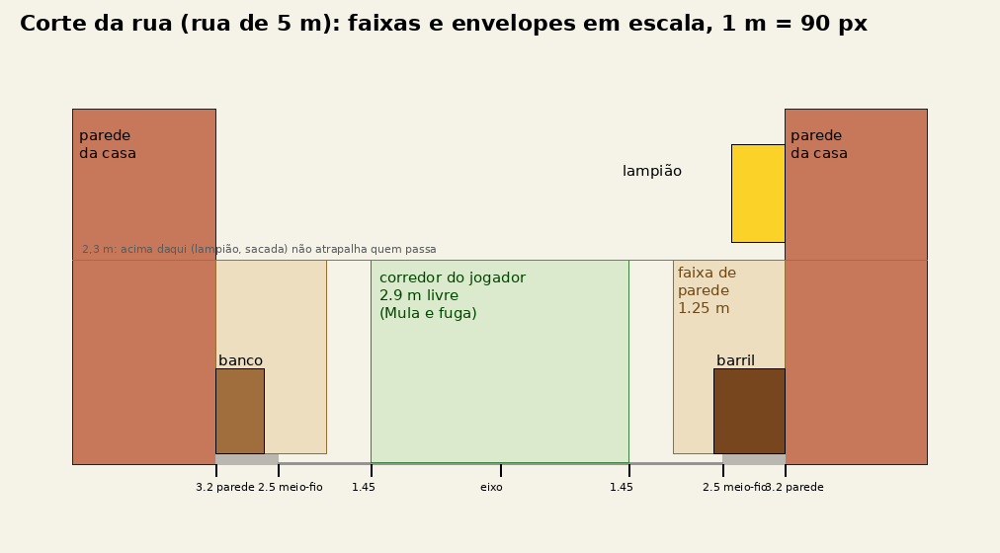

# 31 — Planta mestra (o mapa decidido antes dos objetos)

A planta mestra é a regra do mapa. Cada objeto da rua tem **uma faixa** onde pode ficar e **um envelope**, o espaço máximo que ocupa, já com folga.
Nenhum objeto pode entrar numa **zona proibida** nem no envelope de outro objeto.
O código está em `scripts/planta_mestra.gd`. O bake confere e corrige: desliza o objeto ao longo da parede até a vaga mais próxima que cabe, ou tira o objeto se não houver vaga a menos de 5 m.
Depois de corrigir, confere de novo. As imagens e este documento são gerados por `tools/planta_mestra.gd` + `tools/planta_mestra.py`.

## Faixas da rua (medidas a partir do eixo, para cada lado)

| Faixa | Onde | O que pode |
|---|---|---|
| Corredor do jogador | eixo até 1.45 m | nada sólido: é por onde se anda e se foge da Mula |
| Leito da rua | 1.45 m até o meio-fio (largura/2) | bueiros, poças, pedras soltas rentes ao chão |
| Calçada | meio-fio até a parede (+0.7 m) | postes, carroça, carro coberto |
| Faixa de parede | da parede até 1.25 m para a rua | barris, caixotes, cestos, bancos, oratórios, lousas |
| Alto (acima de 2,3 m) | qualquer ponto | lampiões de parede, sacadas, varais, fios |

## Zonas proibidas

| Zona | Tamanho | Por quê |
|---|---|---|
| Frente de porta | 1,9 m de largura × 1,4 m para fora | a porta tem que abrir e ser vista; em casa visitável, o E entra na sala |
| Boca de beco | largura do beco + 0,4 m × 1,8 m para fora (as duas bocas do beco-escada) | o beco é refúgio: a entrada não pode ter tropeço |
| Volta de item | raio de 0,75 m | frasco, bilhete e medalha ficam à vista e clicáveis; só o apoio deles fica perto |
| Corredor do jogador | 2.9 m no meio da rua | fuga e caminhada sem enroscar |

## Catálogo de envelopes (tamanho máximo de cada tipo de objeto)

| Prefixo do nome | Tipo | Faixa | Largura × fundo × altura (m) | Móvel pela planta |
|---|---|---|---|---|
| wine_barrel | barril | parede | 1.15 × 1.15 × 0.95 | sim |
| Barrel | barril | parede | 0.80 × 0.80 × 0.95 | sim |
| Crate1 | caixote_comprido | parede | 1.15 × 0.80 × 0.85 | sim |
| Crate2 | caixote_comprido | parede | 1.15 × 0.80 × 0.85 | sim |
| Crate | caixote | parede | 0.90 × 0.90 × 1.60 | sim |
| Basket | cesto | parede | 0.65 × 0.65 × 0.60 | sim |
| Bucket | balde | parede | 0.50 × 0.50 × 0.35 | sim |
| Jug | jarro | parede | 0.45 × 0.45 × 0.45 | sim |
| Sack | saco | parede | 0.45 × 0.45 × 0.45 | sim |
| watering_can | regador | parede | 0.50 × 0.40 × 0.25 | sim |
| wooden_bucket | balde | parede | 0.45 × 0.45 × 0.60 | sim |
| wooden_stool | banquinho | parede | 0.60 × 0.60 × 0.50 | sim |
| rusted_wheel_rim | aro | parede | 0.45 × 0.40 × 0.40 | sim |
| Lantern | lanterna | parede | 0.20 × 0.20 × 0.30 | sim |
| BolaEsquecida | bola | parede | 0.55 × 0.30 × 0.25 | sim |
| Televisao | tv_do_bar | parede | 0.70 × 0.60 × 0.50 | não (corrigir na montagem) |
| Lousa | lousa | parede | 1.15 × 1.00 × 1.55 | não (corrigir na montagem) |
| ColBanco | banco | parede | 1.80 × 0.55 × 0.95 | não (corrigir na montagem) |
| ColCarroca | carroca | calcada | 1.75 × 1.15 × 1.00 | não (corrigir na montagem) |
| covered_car | carro_coberto | calcada | 1.85 × 4.45 × 1.45 | não (corrigir na montagem) |
| Pedestal | pedestal | livre | 1.55 × 1.60 × 2.90 | não (corrigir na montagem) |
| Nicho | oratorio | parede | 1.60 × 0.95 × 3.90 | não (corrigir na montagem) |
| Poste | poste | calcada | 0.75 × 0.45 × 3.90 | não (corrigir na montagem) |
| LampiaoParede | lampiao_parede | parede | 0.55 × 0.60 × 1.10 | não (corrigir na montagem) |
| Oleo | item_oleo | livre | 0.20 × 0.20 × 0.40 | não (corrigir na montagem) |
| Bilhete | item_bilhete | livre | 0.50 × 0.50 × 0.05 | não (corrigir na montagem) |
| Reliquia | item_medalha | livre | 0.25 × 0.25 × 0.25 | não (corrigir na montagem) |

Objeto de rua sem tipo no catálogo conta como erro: nada entra no mapa sem envelope definido.

## Ritmo do jogo (o que o jogador encontra a cada 50 m de rua)

| Trecho (s) | Querosene | Medalhas | Bilhetes | Becos (refúgio) | Luzes | Casas visitáveis |
|---|---|---|---|---|---|---|
| 0–50 | 1 | 1 | 1 | 1 | 1 | benedita, padaria |
| 50–100 | 1 | 1 | 0 | 2 | 1 | carpintaria, venda |
| 100–150 | 1 | 1 | 1 | 0 | 0 |  |
| 150–200 | 2 | 1 | 1 | 4 | 3 | barbearia |
| 200–250 | 2 | 1 | 0 | 0 | 1 |  |
| 250–300 | 2 | 2 | 2 | 3 | 1 | escola |
| 300–350 | 2 | 2 | 0 | 1 | 1 |  |
| 350–400 | 0 | 2 | 1 | 0 | 3 | casarao, sineiro |
| 400–450 | 0 | 1 | 0 | 0 | 3 |  |
| 450–500 | 0 | 0 | 0 | 0 | 4 |  |

Trechos sem beco, sem casa visitável **e** sem querosene (a tensão sobe sem nenhum alívio): 400–450

## Resultado da conferência

- Objetos conferidos: 116
- Zonas proibidas: 93
- Fora da planta agora: **0**
- Correções feitas na montagem (bake): 2
  - MOVIDO wooden_stool_01_515 (banquinho): -0.25 m ao longo da parede, de s=96.0 (dentro da zona 'volta_de_item' de Reliquia_01)
  - MOVIDO watering_can_metal_01_526 (regador): 0.25 m ao longo da parede, de s=131.0 (dentro da zona 'volta_de_item' de Reliquia_02)

## Imagens

- Planta inteira: `docs/planta/planta_mestra.png` (1 m = 16 px); reduzida: `planta_mestra_pequena.png`.
- Trechos ampliados (1 m = 40 px):
  - s=0–60: `docs/planta/trechos/trecho_000.png`
  - s=60–120: `docs/planta/trechos/trecho_060.png`
  - s=120–180: `docs/planta/trechos/trecho_120.png`
  - s=180–240: `docs/planta/trechos/trecho_180.png`
  - s=240–300: `docs/planta/trechos/trecho_240.png`
  - s=300–360: `docs/planta/trechos/trecho_300.png`
  - s=360–420: `docs/planta/trechos/trecho_360.png`
  - s=420–480: `docs/planta/trechos/trecho_420.png`
  - s=480–540: `docs/planta/trechos/trecho_480.png`
